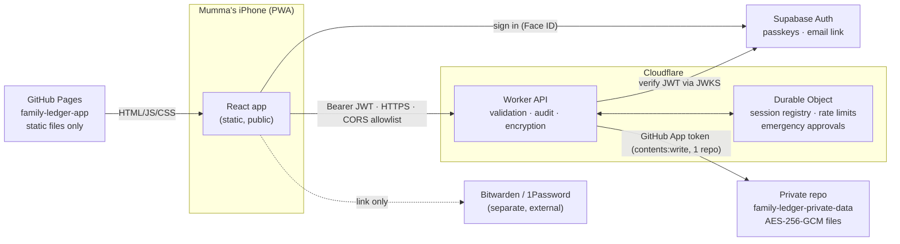

# Architecture

Family Ledger is a static web app (GitHub Pages) that talks to a small authenticated API (Cloudflare Worker). The API is the only thing that can read or write the family's encrypted records, which live in a separate private GitHub repository.



## Repositories

| Repository                     | Visibility    | Contents                                                                                          |
| ------------------------------ | ------------- | ------------------------------------------------------------------------------------------------- |
| `family-ledger-app` (this one) | May be public | Frontend, API, shared domain code, tests, docs, CI, **fictional** demo data                       |
| `family-ledger-private-data`   | **Private**   | Encrypted ledger, encrypted audit log, encrypted snapshots, `FORMAT.md`. Written only by the API. |

Nothing from the private repository is ever fetched by the browser or included in the Pages build. CI runs `scripts/check-pages-artifact.mjs` to refuse publishing keys, tokens, encrypted envelopes, or source maps.

## Code layout

```
packages/shared/     Domain model shared by browser and server (no I/O)
  schema.ts          Zod schemas, SCHEMA_VERSION
  money.ts           BigInt paise arithmetic, lakh/crore parsing & formatting
  commands.ts        Every mutation as a validated command → new state + audit drafts
  calculations.ts    Totals, breakdowns, ownership views, verification status
  audit.ts           Hash-chained audit entries
  masking.ts         Contact-detail masking for browser responses
  urls.ts            Outbound link validation, password-manager links
  sync.ts            Future data-provider boundary (mock only)
  migrations.ts      Schema migration framework
  client.ts          LedgerClient interface + HTTP route map
apps/api/            Cloudflare Worker
  app.ts             Routing, auth pipeline, CORS, fresh-auth gates
  auth.ts            Supabase JWT verification (JWKS, asymmetric only)
  security/          Session registry engine + Durable Object wrapper
  service.ts         LedgerService: load/execute/retry, snapshots, export
  storage/           LedgerStore interface; GitHub and in-memory implementations
  crypto.ts          AES-256-GCM envelope codec with key ids
  backup.ts          Offline verify / re-key of a cloned private repo
apps/web/            React PWA (see apps/web/README.md)
```

## One mutation path

Every change — in the demo and in production — goes through `applyCommand(state, command, {actorId, now})` in `packages/shared/src/commands.ts`. It:

1. validates the command with Zod (unknown or malformed commands are rejected),
2. checks references (people, parent accounts, cycles), masked values, and per-entity `version` for edits,
3. returns a new state plus human-readable audit drafts with before/after values.

The server then hash-chains the audit drafts and commits state + audit atomically. The demo client does the same in browser memory. Because both use the same function, the demo is a faithful rehearsal of real behaviour.

## Concurrency

There are two layers:

- **Entity versions** (inside `applyCommand`): an edit carries `expectedVersion`. If Papa saved the same account first, Mumma's edit fails with `version_conflict` and the API returns Papa's current record so the app can show "Papa changed this while you were editing". Appends (new valuation, new note, new reply) never conflict.
- **Store versions** (inside `LedgerStore.commit`): the GitHub commit's parent is the commit that was read; the branch ref is updated with `force: false`. If anyone else committed in between, GitHub refuses (422) and the service re-reads and re-applies the command (up to 4 attempts). Unrelated simultaneous edits therefore both land; related ones surface as entity conflicts. Nothing is silently overwritten.

## Storage: is GitHub a database?

No. We use it as a versioned, encrypted object store, with these consequences (also see SECURITY.md):

| Concern                 | Assessment and mitigation                                                                                                                                                  |
| ----------------------- | -------------------------------------------------------------------------------------------------------------------------------------------------------------------------- |
| Rate limits             | GitHub App installation tokens get 5,000 requests/hour. A read is 1–3 requests (cached per isolate by commit SHA); a write is ~8. Three family members are far below this. |
| Latency                 | Writes take ~1–2 s (several sequential API calls). Acceptable for manual updates; not for high-frequency data.                                                             |
| Concurrency             | Atomic commits via the Git Data API + non-fast-forward refusal + retry (above). Tested against a fake Git server.                                                          |
| History                 | Every commit's ciphertext is kept forever. Deleting a record does not erase it from history. Key compromise exposes all history encrypted with that key.                   |
| Size                    | The whole ledger is one file (~tens of KB for a family). Comfortable up to a few MB; beyond that, migrate.                                                                 |
| Querying                | None server-side; the API loads the ledger and computes in memory. Fine at family scale.                                                                                   |
| Availability / recovery | Depends on GitHub. Any clone of the private repo is a full encrypted backup; `backup-tool verify` proves it can be decrypted.                                              |
| Metadata leakage        | Commit times, sizes and generic messages (e.g. `valuation.add`) are visible to anyone with repo access. File contents are not.                                             |

**Verdict:** acceptable for V1 at family scale with the mitigations above. When any of the following happens, migrate to PostgreSQL: more than ~10 members, document uploads, automated sync, or a need to truly erase historical data.

### Migrating to PostgreSQL

`LedgerStore` (apps/api/src/storage/types.ts) is the only persistence boundary. A Postgres implementation needs to:

- `load()` → `SELECT state, version FROM ledger` (or normalised tables reassembled into `LedgerState`),
- `commit()` → one transaction: `UPDATE ledger SET state=$1, version=version+1 WHERE version=$expected` (0 rows → `StoreConflictError`), `INSERT` audit rows, optional snapshot row,
- an append-only `audit` table with `REVOKE UPDATE, DELETE` from the application role (strictly stronger than the GitHub hash chain),
- `readAudit()`, `listSnapshots()`, `readSnapshot()`.

Routes, service, commands, calculations and the frontend do not change. Migration = export with `backup-tool export`, import into Postgres, switch `STORAGE_BACKEND`.

## Authentication and sessions

- **Supabase Auth** issues JWTs. Primary sign-in is a **passkey** (Face ID on iPhone); fallback is an emailed sign-in link. Public sign-ups are disabled; family members are invited.
- The Worker verifies JWTs locally against Supabase's JWKS, accepting only asymmetric algorithms (ES256/RS256/EdDSA), the exact issuer, and `aud=authenticated`. Tokens without an `amr` sign-in timestamp are refused (fail closed).
- **Membership** comes from the Worker's `FAMILY_MEMBERS` configuration (id, name, email), not from the database, so a compromised account cannot add members. The first verified sign-in with a member's email binds that Supabase user id; a different user id with the same email is refused.
- **Session registry** (Durable Object, strongly consistent): every request checks the token's `session_id`. This is how revocation, inactivity timeout, maximum session age and emergency pauses take effect immediately, even though Supabase tokens remain cryptographically valid until expiry.
- **Fresh authentication**: revealing sign-in details, export, snapshots, sign-out-everywhere and emergency actions require the sign-in (amr) time to be within `FRESH_AUTH_MINUTES` (default 5). Otherwise the API returns `reauth_required` and the app asks for Face ID again.

## Demo vs connected mode

|             | Demo (`VITE_APP_MODE=demo`)                                      | Connected (`VITE_APP_MODE=connected`)                                                  |
| ----------- | ---------------------------------------------------------------- | -------------------------------------------------------------------------------------- |
| Data        | Fictional seed in browser memory; resets on reload               | Encrypted private repo via API                                                         |
| Sign-in     | "Who's using Family Ledger?" picker (simulation)                 | Supabase passkey / email link                                                          |
| Code        | Demo client loaded by dynamic import only in demo builds         | Demo client is not in the bundle                                                       |
| Guard rails | Build fails if `VITE_API_BASE_URL` is set; permanent demo banner | Build fails without https API URL and Supabase settings; API has no demo bypass at all |

## Future-ready boundaries

- `sync.ts` — `SyncProvider` interface; results become ordinary audited `valuation.add` commands; price-derived values are always "estimated". Only `MockPriceProvider` exists.
- `Account.parentId` + `includedInParentValue` — holdings inside portfolios without double counting.
- `Valuation.currency` — multi-currency ready (non-INR values are currently excluded from totals and flagged).
- `migrations.ts` — ordered schema migrations.
- `DocumentRef` — index only; uploads await encrypted object storage (see ROADMAP.md).
